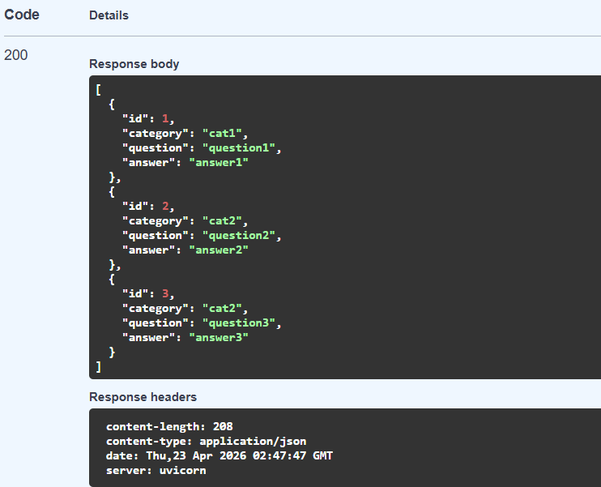

# Flashcard API

I made a flashcard API using FastAPI, Python, and SQLite. It allows users to register an API key and create, view, and delete flashcards. Currently, there is no frontend (It designed in ResolutionWeek5).

## Installation
In order to install the package you will need to run ```pip install -i https://test.pypi.org/simple/ resolution-week4-Asurant``` in your CLI
You have an installation issue involving packages, use this command:
```pip install --index-url https://test.pypi.org/simple/ --extra-index-url https://test.pypi.org/simple/ resolution-week4-Asurant```

## Running The Project
After you install the package you can start the API using:  
```my-api```  
The API will the run locally at:  
```http://127.0.0.1:8000```  
You can access the API documentation and use it at:  
```http://127.0.0.1:8000/docs```

## API Endpoints
| Request | Endpoint | Description |
|---|---|---|
| GET | /flashcards | Gets All Flashcards |
| GET | /secret-data | Tests the API Key Authentication |
| POST | /register | Registers A New User And Makes A New API Key |
| POST | /flashcards | Creates A New Flashcard |
| DELETE | /flashcards/{flashcard_id} | Deletes A Flashcard Based On ID |


